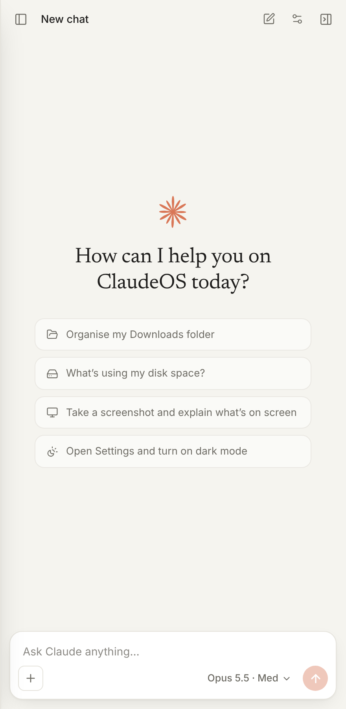
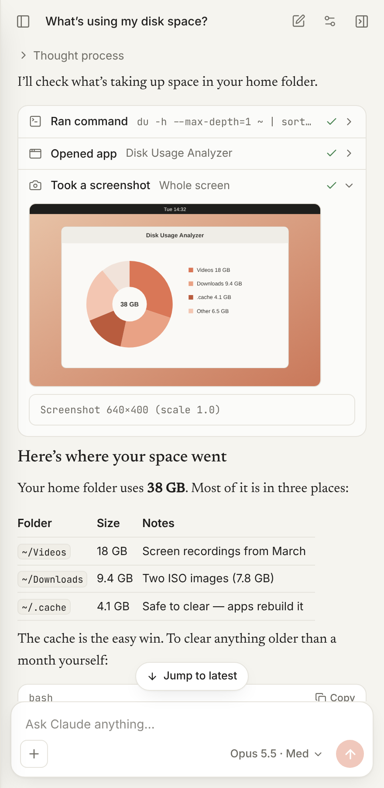
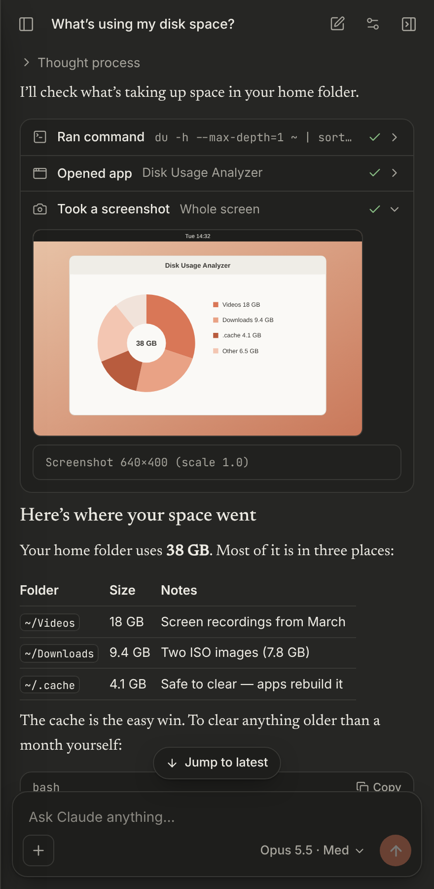
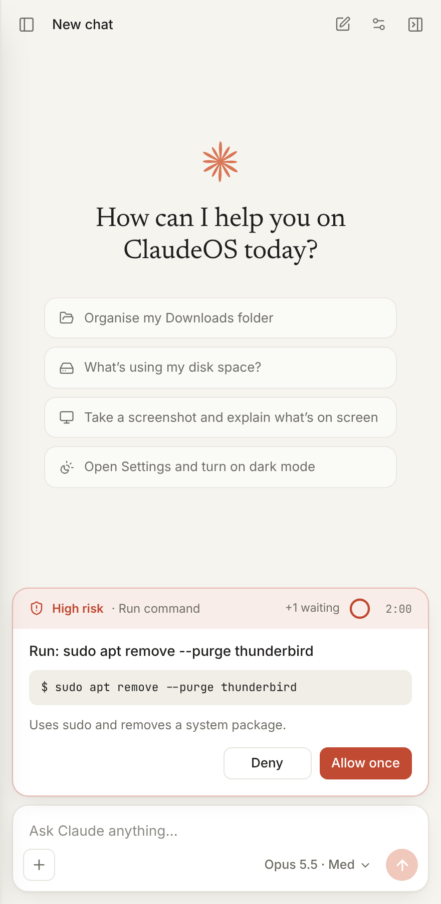
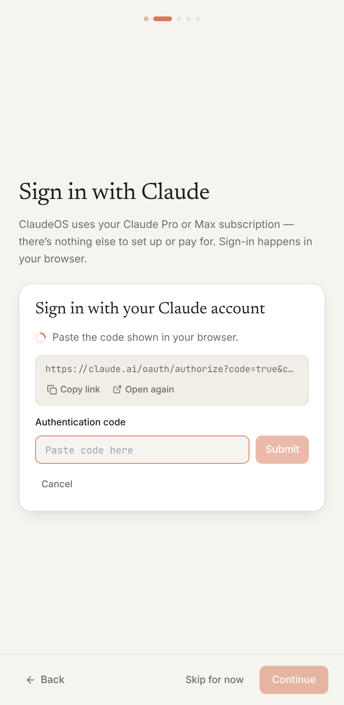

# ClaudeOS

Ubuntu 26.04.1 LTS (Resolute Raccoon, amd64) with the Claude Code CLI built in, a docked Claude-style side panel with full
computer control, an "Ask Claude" action in Files, a Calamares installer and a warm Claude-inspired theme.



## Features

* **Side panel** docked to the desktop: chat, tool-use cards and an approval prompt for risky actions.
* **Computer control** through an MCP server with a layered, fail-closed safety classifier (block / confirm / allow).
* **Ask Claude** in the Nautilus context menu.
* **Subscription sign-in only** (Claude Pro/Max OAuth). No API keys are ever read or accepted.
* Calamares installer, ClaudeOS branding and a light/dark theme (accent `#D97757`).

| Chat | Dark | Approval | Sign-in |
|---|---|---|---|
|  |  |  |  |

## Status (honest)

Unit tests use fakes (`CLAUDEOS_CLAUDE_BIN`, stubbed `gi`, mocked subprocess). The ISO build, booting the ISO, Wayland input
injection and the live `claude` stream have **not** been exercised on real systems from our CI-less sandboxes.
See `docs/BUILDING.md` for the verified / not-verified list.

## Quick start

Download the release parts, then:

```bash
scripts/join-iso.sh ./downloads          # joins claudeos-26.04.1-amd64.iso.part-* and verifies SHA256
qemu-system-x86_64 -enable-kvm -m 6G -cdrom claudeos-26.04.1-amd64.iso -boot d
```

Sign in with your Claude subscription on first boot (`claude auth login --claudeai`).

## Build

```bash
make ci      # lint + tests for every module
make debs    # packages -> iso-builder/out/debs
make iso     # needs root, network, ~45 GB; see docs/BUILDING.md
```

## Repository map

| Path | What |
|---|---|
| `side-panel/` | Electron + React docked panel, `claudeos-panel` launcher, onboarding |
| `computer-control-mcp/` | MCP server `claudeos-desktop` + safety classifier |
| `nautilus-extension/` | "Ask Claude" Files action |
| `calamares-config/` | installer config, branding, slideshow |
| `system-config/` | OS prompt, managed Claude Code settings, first boot, doctor |
| `theme/` | theme, wallpapers, dconf |
| `iso-builder/`, `scripts/`, `.github/` | deb packaging, ISO pipeline, CI |
| `docs/` | `ARCHITECTURE.md` (contracts), `BUILDING.md` |
